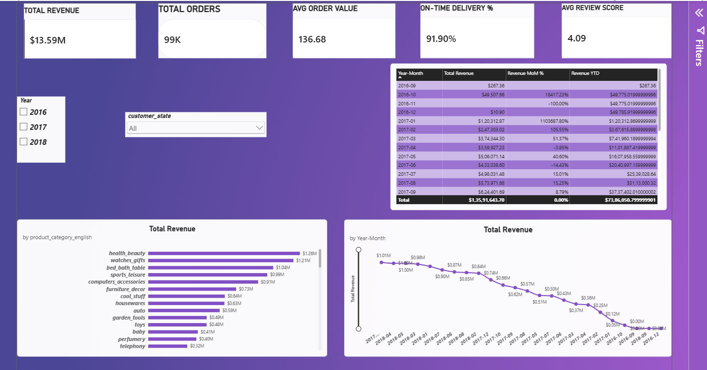
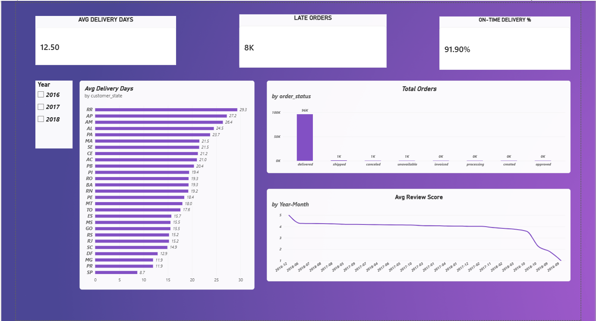
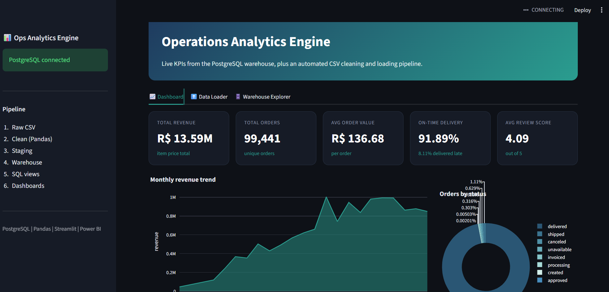
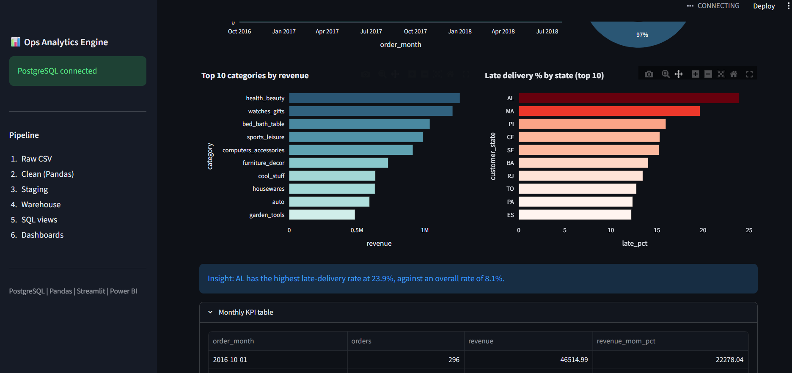
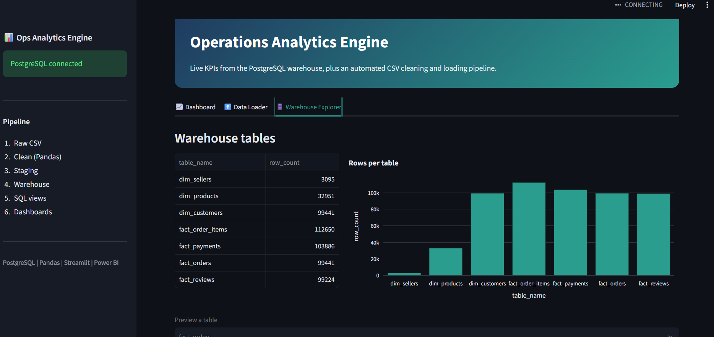

# Dynamic Corporate Operations Analytics Engine

End-to-end data engineering and BI pipeline on the Olist Brazilian e-commerce dataset (99,441 orders, 1.5M+ raw rows across 9 tables).

**Stack:** PostgreSQL, Python (Pandas, NumPy, SQLAlchemy), Power BI (DAX), Streamlit

## Architecture

```
Raw CSVs -> Python cleaning and EDA ----+
                                         +--> PostgreSQL staging -> warehouse (star schema) -> SQL views -> Power BI dashboard
Raw CSVs -> Streamlit upload and clean --+
```

## What is inside

- **Relational schema:** `staging` (raw) and `warehouse` (clean) schemas, star schema with dimension and fact tables, primary and foreign keys, and indexes on join and filter columns.
- **ETL and EDA (Pandas, NumPy):** missing value handling, type fixes, spelling fixes, text standardisation, and feature engineering (`delivery_delay_days`, `is_late`).
- **SQL layer:** analytics views using CTEs and window functions (`LAG`, `RANK`).
- **Power BI dashboard:** 2 pages, multi-table relationships, a date table, and DAX measures (Total Revenue, Avg Order Value, On-Time Delivery %, Revenue MoM %, Revenue YTD, Avg Delivery Days, Avg Review Score).
- **Streamlit app:** KPI dashboard with live charts, a CSV loader (auto-detect table, data quality report, clean and load into the warehouse with idempotent inserts), and a warehouse explorer.

## Key findings

- 91.89% of delivered orders arrived on time.
- Late deliveries are concentrated in north-east states (AL 23.9%, MA 19.7%, PI 16.0%) against an overall rate of about 8%.
- Total revenue is about 13.59M BRL across 99,441 orders (average order value about 137 BRL).

## Screenshots

## Screenshots







## How to run

1. Install PostgreSQL and create a database `ops_analytics`.
2. `pip install -r requirements.txt`
3. Copy `.env.example` to `.env` and set `DB_PASSWORD`.
4. Download the Olist dataset from Kaggle into `data/raw/`.
5. Run in order:

```
python etl/run_sql.py sql/01_schema.sql
python etl/load_staging.py
python etl/clean_load.py
python etl/run_sql.py sql/03_indexes.sql
python etl/run_sql.py sql/04_views.sql
streamlit run app/streamlit_app.py
```

Dataset: Olist Brazilian E-Commerce Public Dataset (Kaggle).